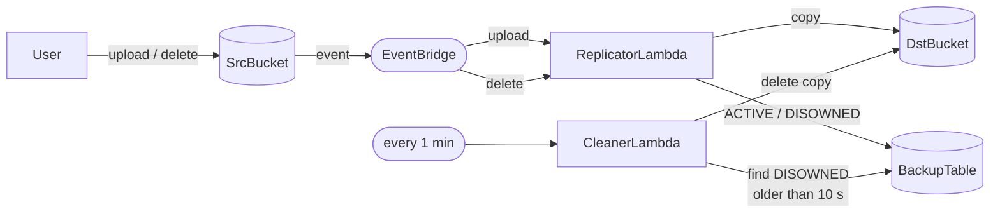

# s3-backup-system-cdk

An automatic backup for an S3 bucket. Every file you upload gets copied to a second bucket, up to 3 versions are kept per file, and the copies are removed shortly after the original is deleted.

I built it with AWS CDK in Python to practice event-driven serverless design: S3 events, EventBridge, Lambda and DynamoDB.



## How it works

**When a file is uploaded:**

1. `ReplicatorLambda` copies it to `DstBucket` as `{name}_{timestamp}`.
2. It writes an ACTIVE row to DynamoDB.
3. If that file now has more than 3 copies, it deletes the oldest one.

**When a file is deleted:**

1. `ReplicatorLambda` marks all its copies as DISOWNED, with the time. It doesn't delete them yet.
2. Every minute, `CleanerLambda` finds DISOWNED copies older than 10 seconds (through a DynamoDB index) and deletes them.

So a deleted file's backups disappear within about a minute.

The app is split into 3 CDK stacks: `StorageStack` (the two buckets and the table), `ReplicatorStack` and `CleanerStack` (each with its Lambda and EventBridge rule). Storage deploys first.

## Requirements

- **Python 3** and the **AWS CDK CLI** (`npm install -g aws-cdk`, needs Node.js)
- An AWS account with credentials set up and CDK bootstrapped (`cdk bootstrap`)

## Run

In PowerShell, from the project folder:

```powershell
python -m venv .venv
.\.venv\Scripts\Activate.ps1
pip install -r requirements.txt
cdk deploy --all
```

Then upload and delete files in `SrcBucket` (console or CLI) and watch `DstBucket` and `BackupTable`.

Remove everything when you're done (this deletes all data):

```powershell
cdk destroy --all
```

## Code

```
app.py                            CDK entry point: Storage → Replicator → Cleaner
backup_system/
  storage_stack.py                buckets, table, status index
  replicator_stack.py             ReplicatorLambda + upload/delete rules
  cleaner_stack.py                CleanerLambda + 1-minute schedule
lambda/
  replicator.py                   copy + trim to 3 on upload, mark DISOWNED on delete
  cleaner.py                      delete DISOWNED copies past the 10 s cutoff
```
